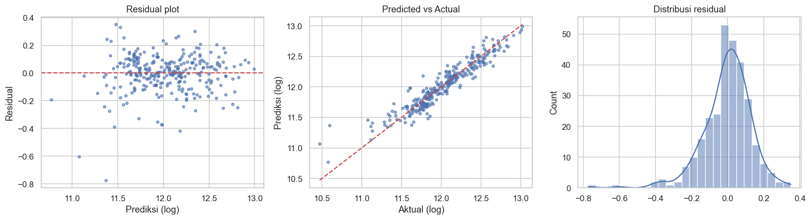
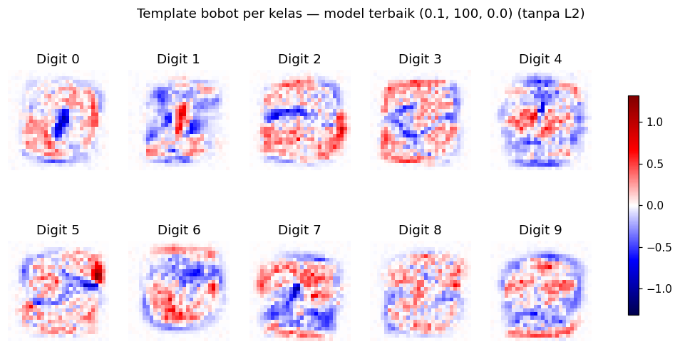
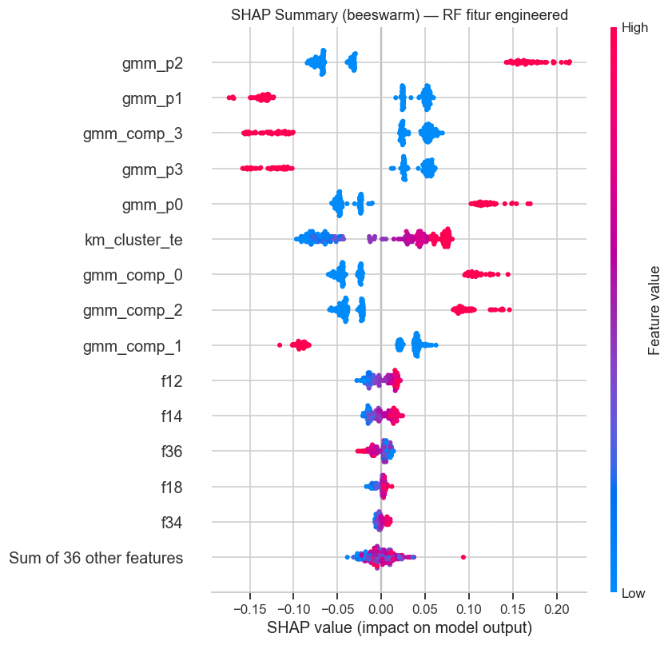

# Machine Learning Fundamentals

Three end-to-end machine learning studies on classic Kaggle datasets, covering **regression**, **multiclass classification**, and **tree ensembles with explainable AI**. Each notebook goes beyond calling a library: models are implemented from scratch where it matters, verified against reference implementations, and evaluated with leakage-safe validation.


## Overview

| # | Notebook | Task | Key techniques | Result |
|---|----------|------|----------------|--------|
| 01 | [Linear Regression: House Prices](notebooks/01_linear_regression_house_prices.ipynb) | Regression | OLS from scratch (Normal Equation + Gradient Descent), VIF multicollinearity analysis, Ridge / Lasso, K-Fold CV | **R² 0.891** (5-fold CV), Kaggle **MAE $15,747** |
| 02 | [Softmax Regression from Scratch: Digits](notebooks/02_softmax_regression_from_scratch_digits.ipynb) | 10-class image classification | Softmax + cross-entropy in pure NumPy, mini-batch GD, gradient check, L2 regularization, 12-config hyperparameter grid | **92.25%** test accuracy |
| 03 | [Tree Ensembles + SHAP: Data Science London](notebooks/03_tree_ensembles_shap_data_science_london.ipynb) | Binary classification | Semi-supervised GMM feature engineering, target encoding, Decision Tree / Random Forest / XGBoost, SHAP | **87.5% → 99.0%** test accuracy |

---

## 01 · Linear Regression: House Prices (Ames, Iowa)

Predicting house sale prices from 79 features on the Kaggle [Housing Prices Competition](https://www.kaggle.com/competitions/home-data-for-ml-course).

- **From-scratch OLS:** the Normal Equation and Gradient Descent are implemented in NumPy and match scikit-learn's coefficients to within **5 × 10⁻¹⁵**.
- **Multicollinearity:** iterative VIF analysis, computed manually, removes perfectly collinear derived features (e.g. `GrLivArea = 1stFlrSF + 2ndFlrSF + LowQualFinSF`) and brings the maximum VIF from ∞ down to 5.7.
- **Leakage prevention:** imputation, scaling, and feature selection are fitted only on training folds, inside a `Pipeline`.
- **Regularization:** Ridge and Lasso are tuned with GridSearchCV. Lasso sets 6 weak features exactly to zero.
- **Business view:** the error is translated into dollars, with a median absolute percentage error of **7.3%**, an over/under-valuation split, and its impact across 1,000 transactions.

| Metric | Value |
|--------|-------|
| 5-fold CV RMSE (log price) | 0.130 ± 0.010 |
| 5-fold CV R² | 0.891 ± 0.011 |
| Hold-out MAE | $16,525 |
| Kaggle leaderboard MAE | **$15,747** |



## 02 · Softmax Regression from Scratch: Digit Recognizer

Handwritten digit classification (28×28 pixels, 42,000 images) on the Kaggle [Digit Recognizer](https://www.kaggle.com/competitions/digit-recognizer) dataset. **The model core uses only NumPy:** no scikit-learn and no pandas.

- Numerically stable softmax, cross-entropy loss with L2, analytic gradients, and mini-batch gradient descent.
- A **gradient check** against finite differences gives a maximum relative error of **4.5 × 10⁻⁹**.
- Experiment grid: learning rate {0.1, 0.01, 0.001} × epochs {50, 100} × L2 λ {0, 0.01}, 12 runs in total, all with the same seed.
- Error analysis: confusion matrix, the most-confused pairs (4→9, 9→7, 3→5), and the learned weights visualized as per-class templates.

| Best configuration | Train acc. | Test acc. |
|--------------------|-----------:|----------:|
| lr = 0.1, 100 epochs, no L2 | 93.64% | **92.25%** |



## 03 · Decision Tree, Random Forest & XGBoost with SHAP: Data Science London

Binary classification on 40 anonymous features from the Kaggle [Data Science London + Scikit-learn](https://www.kaggle.com/competitions/data-science-london-scikit-learn) competition, with a focus on **feature engineering** and **explainable AI**.

- **Semi-supervised feature engineering:** a Gaussian Mixture Model (k = 4, chosen by BIC) is fitted on 10,000 *unlabeled* rows. Its posterior probabilities become new features, and each component turns out to align almost perfectly with one class.
- **Leakage control experiment:** refitting the GMM without the validation/test rows gives identical scores. This shows the gain comes from the data structure, not from leakage.
- **Encoding:** one-hot encoding for low-cardinality features, and cross-fitted target encoding for the 16-cluster KMeans feature.
- **Models:** Decision Tree, Random Forest (bagging), and XGBoost (boosting), each tuned with stratified 5-fold GridSearchCV.
- **Explainability:** SHAP beeswarm plots for global behavior, waterfall plots for one correct and one wrong prediction, and a comparison of SHAP against impurity-based importance (Spearman ρ = 0.96).

| Test accuracy (200 held-out samples) | Raw features | Engineered features |
|--------------------------------------|-------------:|--------------------:|
| Decision Tree | 76.0% | **99.0%** |
| Random Forest | 87.5% | **99.0%** |
| XGBoost | 86.5% | **99.0%** |

> **Takeaway:** understanding the data's structure mattered more than the choice of algorithm. With good features, even a depth-3 decision tree reaches 99%.



---

## Repository structure

```
machine-learning-fundamentals/
├── notebooks/        # the three analysis notebooks (outputs included)
├── data/             # Kaggle datasets go here (not tracked, see data/README.md)
├── images/           # figures used in this README
├── requirements.txt
└── LICENSE
```

## Getting started

```bash
git clone https://github.com/abdurrahmanzabron/machine-learning-fundamentals.git
cd machine-learning-fundamentals
python -m venv .venv
source .venv/bin/activate        # Windows: .venv\Scripts\activate
pip install -r requirements.txt
```

1. Download the datasets into `data/` by following [`data/README.md`](data/README.md).
2. Start Jupyter and open any notebook in `notebooks/`:
   ```bash
   jupyter notebook
   ```

All randomness is seeded (`SEED = 42`), so results are reproducible.

## Notes

- Identifiers in the code are in English. The explanations, comments, and printed output inside the notebooks are written in **Bahasa Indonesia**.
- The datasets belong to their respective Kaggle competitions and are not redistributed here.
- Developed with AI assistance (Claude Code). The references section at the end of each notebook documents the sources and tools that were used.

## License

The code in this repository is released under the [MIT License](LICENSE).
